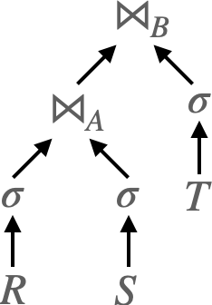
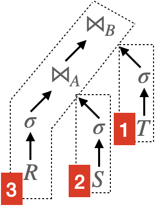

import Code from '../../../components/Code.astro';
import Collapse from '../../../components/Collapse.astro';

**2026-09-10 Updated** Finish "DuckDB Implementation".

DuckDB implements morsel-driven parallelism, a NUMA-aware query evaluation framework. This post introduces the morsel model and its implementation in DuckDB.

## Morsel Model

Morsel model is an improvement on execution engines. Most traditional execution engines employ the volcano model. To compare these two models, we consider the following query plan from the origin paper:

$$
\sigma(R) \bowtie_A \sigma(S) \bowtie_B \sigma(T)
$$

The relational algebra expression above will be translated into a physical plan as shown below. Here $\bowtie$ represents a hash join, and its LHS is the probe side, and RHS is the build side.



In the volcano model, each operator represents a node in the physical plan graph. And each operator has a `Next` method. Say a hash join operator having fields `left` and `right`, its `Next` method will be like:

<Code line-number={false} wraparound={true}>

```text
HashJoin::Next() {
    for t = right.Next(); do
        build_hash_table(t);
    done
    for t = left.Next(); do
        if probe_hash_table(t); do
            yield join(t);
        done
    done
}
```

</Code>

In the morsel model, operators are grouped into pipelines. The above query plan can be divided into three pipelines as follows.



Operators of one **pipeline** can be executed before others finish. In pipeline 1, for example, table scan, filter, and build hash table can be executed concurrently. That is, when the table scan operator reads a morsel of data, although the table is not fully scanned, the filter operator can start processing on that morsel of data.

A **pipeline breaker** is a operator that must finish before its next operator can start, for example, sort operator (`order by`). In the above example, the build side of hash join operator is a pipeline breaker (the probe side is not). Pipeline breaker breaks the plan into multiple pipelines, and creates a dependency between them.

The main idea of the morsel model is to apply as many operators as possible to a morsel of data before moving to the next morsel. This can reduce the overhead of transferring data between cores in modern NUMA architectures.

## DuckDB Implementation

### `PhysicalOperator`

DuckDB physical plan is a tree of `PhysicalOperator`. From the POV of pipeline execution, `PhysicalOperator` has three roles.

#### Regular

A regular operator mainly has to implement `Execute`, which transforms an input chunk into an output chunk. Examples include filters, projections, and the probe side of a hash join.

<Code line-number={false} wraparound={true}>

```cpp
class PhysicalOperator {
public:
	//! Transform input into chunk using the shared and local states.
	virtual OperatorResultType Execute(ExecutionContext &context, DataChunk &input, DataChunk &chunk,
	                                   GlobalOperatorState &gstate, OperatorState &state) const;
};
```

</Code>

`Execute` returns one of these `OperatorResultType` values:

- `NEED_MORE_INPUT` means the current input has been consumed.
- `HAVE_MORE_OUTPUT` tells the executor to call the operator again with the same input, which is useful when one input chunk produces several output chunks.
- `FINISHED` stops the whole pipeline early.

#### Source

A source starts a pipeline. Each call to `GetData` fills a `DataChunk` with the next vector of rows.

<Code line-number={false} wraparound={true}>

```cpp
class PhysicalOperator {
public:
	//! Whether this operator can be the source of a pipeline.
	virtual bool IsSource() const;
	//! Whether multiple tasks may read from this source concurrently.
	virtual bool ParallelSource() const;

	//! Fill chunk with the next vector of rows from this source.
	SourceResultType GetData(ExecutionContext &context, DataChunk &chunk, OperatorSourceInput &input) const;
};
```

</Code>

A parallel source partitions its work through `GlobalSourceState`, allowing multiple tasks to call `GetData` concurrently.

#### Sink

A sink ends a pipeline. `Sink` consumes each incoming chunk and updates sink state instead of returning another chunk.

<Code line-number={false} wraparound={true}>

```cpp
class PhysicalOperator {
public:
	//! Whether this operator can be the sink of a pipeline.
	virtual bool IsSink() const;
	//! Whether multiple tasks may write to this sink concurrently.
	virtual bool ParallelSink() const;

	//! Consume an input chunk and update the local or global sink state.
	virtual SinkResultType Sink(ExecutionContext &context, DataChunk &chunk, OperatorSinkInput &input) const;
	//! Merge one executor's local sink state into the global sink state.
	virtual SinkCombineResultType Combine(ExecutionContext &context, OperatorSinkCombineInput &input) const;
	//! Finalize the shared sink state after every executor has combined.
	virtual SinkFinalizeType Finalize(Pipeline &pipeline, Event &event, ClientContext &context,
	                                  OperatorSinkFinalizeInput &input) const;
};
```

</Code>

For a parallel sink, every executor updates its own `LocalSinkState`. After an executor has consumed all of its own source work, it combines the local state into the shared `GlobalSinkState`. Once every executor has combined, DuckDB crosses an event barrier and invokes `Finalize` once for the shared state.

An operator might have more than one role. For example, one `PhysicalHashJoin` is placed in two pipelines: the build pipeline ends at its sink interface, while the probe pipeline uses its regular interface.

### Pipeline

<Code line-number={false} wraparound={true}>

```cpp
class Pipeline {
    // ...
	optional_ptr<PhysicalOperator> source;
	vector<reference<PhysicalOperator>> operators;
	optional_ptr<PhysicalOperator> sink;

	vector<weak_ptr<Pipeline>> parents;
	vector<weak_ptr<Pipeline>> dependencies;
	// ...
};
```

</Code>

#### Building the Pipeline Graph

<Collapse open>
<Fragment slot='summary'>Given a physical plan, `Executor::InitializeInternal` constructs the pipeline graph.</Fragment>

<Code line-number={false} wraparound={true}>

```cpp
class Executor {
	void InitializeInternal(PhysicalOperator &plan) {
		physical_plan = &plan;

		//! Build pipelines from the physical operator tree.
		PipelineBuildState state;
		auto root = make_shared_ptr<MetaPipeline>(*this, state, nullptr);
		root->Build(*physical_plan);

		//! Collect all non-root meta-pipelines that need to be scheduled.
		vector<shared_ptr<MetaPipeline>> to_schedule;
		root->GetMetaPipelines(to_schedule, true, true);
		state.ResolveExternalInputs(to_schedule);
		root->Ready();

		//! Retain the result pipelines and all pipelines for execution metadata.
		root->GetPipelines(root_pipelines, false);
		root->GetPipelines(pipelines, true);

		//! Lower pipeline dependencies to events and submit ready work.
		ScheduleEvents(to_schedule);
	}
};
```

</Code>

</Collapse>

<Collapse open>
<Fragment slot='summary'>`MetaPipeline::Build` delegates pipeline construction to `PhysicalOperator::BuildPipelines`.</Fragment>

<Code line-number={false} wraparound={true}>

```cpp
class PhysicalOperator {
public:
	virtual void BuildPipelines(Pipeline &current, MetaPipeline &meta_pipeline) {
		auto &state = meta_pipeline.GetState();

		if (!IsSink() && children.empty()) {
			//! A leaf non-sink starts the current pipeline.
			state.SetPipelineSource(current, *this);
			return;
		}

		if (IsSink()) {
			//! The sink is also the source above this pipeline boundary.
			state.SetPipelineSource(current, *this);

			//! Build its input in a child meta-pipeline sharing this sink.
			auto &child = meta_pipeline.CreateChildMetaPipeline(current, *this);
			child.Build(children[0].get());
			return;
		}

		//! A streaming operator remains inside the current pipeline.
		state.AddPipelineOperator(current, *this);
		children[0].get().BuildPipelines(current, meta_pipeline);
	}
};
```

</Code>

</Collapse>

A pipeline breaker often exposes different roles on either side of the boundary. A hash join, for example, is the sink of its build pipeline: input chunks from the right child are inserted into the hash table. After that pipeline is finalized, the same join is an intermediate operator in the probe pipeline: chunks from the left child pass through `Execute` and probe the completed table.

<Collapse>
<Fragment slot='summary'>
Operators with multiple inputs override `BuildPipelines`. For example, `PhysicalUnion` creates one pipeline per child while reusing the downstream operators and sink.
</Fragment>

<Code line-number={true} wraparound={true}>

```cpp
class PhysicalUnion : public PhysicalOperator {
public:
	void BuildPipelines(Pipeline &current, MetaPipeline &meta_pipeline) override {
		bool order_matters = !allow_out_of_order || current.IsOrderDependent();

		//! Clone the current pipeline for every branch after the first.
		vector<reference<Pipeline>> union_pipelines;
		for (idx_t i = 0; i + 1 < children.size(); i++) {
			union_pipelines.push_back(meta_pipeline.CreateUnionPipeline(current, order_matters));
		}

		//! The first branch continues in the current pipeline.
		children[0].get().BuildPipelines(current, meta_pipeline);

		//! Build every remaining branch in one of the cloned pipelines.
		for (idx_t i = 1; i < children.size(); i++) {
			auto &pipeline = union_pipelines[children.size() - i - 1].get();
			if (order_matters) {
				meta_pipeline.AddDependenciesFrom(pipeline, pipeline, false,
				                                  MetaPipelineDependencyType::REQUIRED);
			}
			meta_pipeline.AssignNextBatchIndex(pipeline);
			children[i].get().BuildPipelines(pipeline, meta_pipeline);
		}
	}
};
```

</Code>

</Collapse>

#### Executing One Pipeline

<Collapse>
<Fragment slot='summary'>Given a pipeline, `PipelineExecutor::Execute` repeatedly fetches source chunks and pushes them through the pipeline.</Fragment>

<Code line-number={true} wraparound={true}>

```cpp
class PipelineExecutor {
public:
	PipelineExecuteResult Execute(idx_t max_chunks) {
		auto &source_chunk = pipeline.operators.empty() ? final_chunk : *intermediate_chunks[0];
		ExecutionBudget chunk_budget(max_chunks);

		do {
			OperatorResultType result;

			if (!in_process_operators.empty() && !started_flushing) {
				//! Resume an operator that returned HAVE_MORE_OUTPUT.
				result = ExecutePushInternal(source_chunk, chunk_budget);
			} else if (exhausted_pipeline) {
				//! Flush intermediate state, then combine the local sink state.
				return FlushAndFinalize(chunk_budget);
			} else {
				source_chunk.Reset();
				auto source_result = FetchFromSource(source_chunk);

				if (source_result.result == SourceResultType::BLOCKED) {
					return PipelineExecuteResult::INTERRUPTED;
				}
				if (source_result.result == SourceResultType::FINISHED) {
					exhausted_pipeline = true;
				}
				if (exhausted_pipeline && source_chunk.size() == 0) {
					continue;
				}

				result = ExecutePushInternal(source_chunk, chunk_budget);
			}

			if (result == OperatorResultType::BLOCKED) {
				remaining_sink_chunk = true;
				return PipelineExecuteResult::INTERRUPTED;
			}
			if (result == OperatorResultType::FINISHED) {
				exhausted_pipeline = true;
			}
		} while (chunk_budget.Next());

		return PipelineExecuteResult::NOT_FINISHED;
	}
};
```

</Code>

</Collapse>

<Collapse>
<Fragment slot='summary'>`ExecutePushInternal` passes a chunk through the intermediate operators and into the sink, preserving operators that have more output.</Fragment>

<Code line-number={false} wraparound={true}>

```cpp
//! Inside PipelineExecutor::Execute(input, result):
auto op_result = current_operator.Execute(context, prev_chunk, current_chunk,
                                          *current_operator.op_state,
                                          *intermediate_states[current_intermediate - 1]);

if (op_result == OperatorResultType::HAVE_MORE_OUTPUT) {
	//! Resume this operator later with the same upstream input.
	in_process_operators.push(current_idx);
} else if (op_result == OperatorResultType::FINISHED) {
	FinishProcessing(NumericCast<int32_t>(current_idx));
	return OperatorResultType::FINISHED;
}

//! After the final intermediate operator, consume the output.
OperatorSinkInput sink_input {*pipeline.sink->sink_state, *local_sink_state, interrupt_state};
auto sink_result = Sink(final_chunk, sink_input);
```

</Code>

</Collapse>

<Collapse>
<Fragment slot='summary'>After the source is exhausted, `PushFinalize` combines one executor's local sink state.</Fragment>

<Code line-number={false} wraparound={true}>

```cpp
class PipelineExecutor {
public:
	PipelineExecuteResult PushFinalize() {
		OperatorSinkCombineInput input {*pipeline.sink->sink_state,
		                                *local_sink_state,
		                                interrupt_state};

		if (pipeline.sink->Combine(context, input) == SinkCombineResultType::BLOCKED) {
			return PipelineExecuteResult::INTERRUPTED;
		}

		finalized = true;
		NotifySourceFinished();
		pipeline.executor.Flush(thread);
		return PipelineExecuteResult::FINISHED;
	}
};
```

</Code>

</Collapse>

#### Executing the Pipeline Graph

<Collapse>
<Fragment slot='summary'>`BuildPipelineSchedule` lowers each pipeline into five stages and connects them in a dependency DAG.</Fragment>

<Code line-number={false} wraparound={true}>

```cpp
static PipelineScheduleStageStack AddBasePipeline(PipelineSchedule &result,
                                                   const shared_ptr<Pipeline> &pipeline) {
	auto initialize = AddStage(result, PipelineScheduleStageType::INITIALIZE, pipeline);
	auto execute = AddStage(result, PipelineScheduleStageType::EXECUTE, pipeline);
	auto prepare = AddStage(result, PipelineScheduleStageType::PREPARE_FINISH, pipeline);
	auto finish = AddStage(result, PipelineScheduleStageType::FINISH, pipeline);
	auto complete = AddStage(result, PipelineScheduleStageType::COMPLETE, pipeline);

	//! INITIALIZE -> EXECUTE -> PREPARE_FINISH -> FINISH -> COMPLETE
	AddDependency(result, execute, initialize);
	AddDependency(result, prepare, execute);
	AddDependency(result, finish, prepare);
	AddDependency(result, complete, finish);
	return {initialize, execute, prepare, finish, complete};
}

//! Add edges between pipelines.
for (auto &entry : stage_map) {
	auto &pipeline = entry.first.get();
	for (auto &dependency : pipeline.GetDependencies()) {
		auto producer = stage_map.find(*dependency.lock());
		//! A blocking dependency waits for complete finalization.
		AddDependency(*result, entry.second.execute, producer->second.complete);
	}
	for (auto &dependency : pipeline.GetDataflowDependencies()) {
		auto producer = stage_map.find(*dependency.lock());
		//! A streaming dependency waits only for shared-state initialization.
		AddDependency(*result, entry.second.execute, producer->second.initialize);
	}
}
```

</Code>

</Collapse>

Additional branches in `BuildPipelineSchedule` share finish stages among pipelines in one `MetaPipeline` and add ordering for sibling join builds and external inputs.

<Collapse>
<Fragment slot='summary'>`Executor::ScheduleEventsInternal` materializes the stages as events, attaches their edges, and schedules the DAG roots</Fragment>

<Code line-number={true} wraparound={true} show-whitespace={true}>

```cpp
class Executor {
	void ScheduleEventsInternal(ScheduleEventData &event_data) {
		auto schedule = BuildPipelineSchedule(event_data.meta_pipelines);

		for (auto &stage : schedule->stages) {
			events.push_back(CreatePipelineScheduleEvent(stage, event_data.initial_schedule));
		}
		for (idx_t stage_idx = 0; stage_idx < schedule->stages.size(); stage_idx++) {
			for (auto dependency : schedule->stages[stage_idx].dependencies) {
				events[stage_idx]->AddDependency(*events[dependency]);
			}
		}

		for (auto &event : events) {
			if (!event->HasDependencies()) {
				event->Schedule();
				if (!event->HasTasks() && event->AutoFinishWithoutTasks()) {
					event->Finish();
				}
			}
		}
	}
};
```

</Code>

</Collapse>

`CreatePipelineScheduleEvent` maps the five stages to `PipelineInitializeEvent`, `PipelineEvent`, `PipelinePrepareFinishEvent`, `PipelineFinishEvent`, and `PipelineCompleteEvent`. Each event schedules its own tasks. The `EXECUTE` event, for example, calls `Pipeline::Schedule`, which creates `PipelineTask`s according to the pipeline's available parallelism.

<Collapse>
<Fragment slot='summary'>An event counts its tasks and dependencies, releasing dependent events after its last task finishes</Fragment>

<Code line-number={false} wraparound={true}>

```cpp
class Event {
public:
	void FinishTask() {
		if (++finished_tasks == total_tasks) {
			Finish();
		}
	}

	void Finish() {
		FinishEvent();
		finished = true;
		for (auto &entry : parents) {
			if (auto dependent = entry.lock()) {
				dependent->CompleteDependency();
			}
		}
		FinalizeFinish();
	}

	void CompleteDependency() {
		if (++finished_dependencies == total_dependencies) {
			Schedule();
			if (total_tasks == 0 && AutoFinishWithoutTasks()) {
				Finish();
			}
		}
	}
};
```

</Code>

</Collapse>

A `PipelineTask` finishes only after `PipelineExecutor::PushFinalize` has successfully called the sink's `Combine`. The `PREPARE_FINISH` event therefore invokes `PrepareFinalize` after every local sink state has been combined. The `FINISH` event then runs required intermediate-operator finalizers and the sink's `Finalize` in one task.

For a hash join, the probe pipeline's `EXECUTE` stage depends on the build pipeline's `COMPLETE` stage. This guarantees that the build-side hash table is finalized before probing begins. The event DAG preserves such pipeline-breaker dependencies while independent pipelines and tasks run in parallel.

## Closing Thoughts

### Pipeline Is About Parallelism

A pipeline-based executor exposes two kinds of intra-query parallelism:

- **Intra-pipeline parallelism:** multiple workers execute the same pipeline over different morsels.
- **Inter-pipeline parallelism:** pipelines whose dependencies are satisfied can execute concurrently.

A pipeline is a maximal chain in which each `DataChunk` can flow from source through intermediate operators to the sink without materializing the complete intermediate result. Pipeline breakers do not group these operators; they delimit such chains. A break introduces a dependency when the sink phase must finish before the downstream phase can begin.

### Pipeline Graph as an IR

Similar to a compiler, we can consider the pipeline graph a lower-level query IR, following the parsed AST, bound AST, logical plan, and physical plan.

|       IR Level | Focus                                                         |
| -------------: | :------------------------------------------------------------ |
|   logical plan | relational algebra transformations |
|  physical plan | physical operator and algorithm selection                     |
| pipeline graph | parallelism and cache locality                                |

<Code line-number={false} wraparound={true}>

```text
SQL
 ↓ parsing, binding
Logical plan (Scan, Filter, Join, Aggregate, ...)
 ↓ optimization and physical algorithm selection
Physical plan (TableScan, Filter, HashJoin, HashAggregate, ...)
 ↓ decompose operator phases and form pipelines
Pipeline graph
   Pipelines + shared state + dependencies
```

</Code>

## References

1. [_Morsel-Driven Parallelism: A NUMA-Aware Query Evaluation Framework for the Many-Core Age_](https://db.in.tum.de/~leis/papers/morsels.pdf) originally proposes the morsel model.
